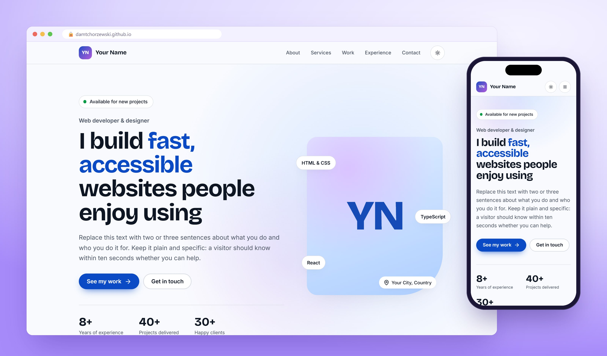
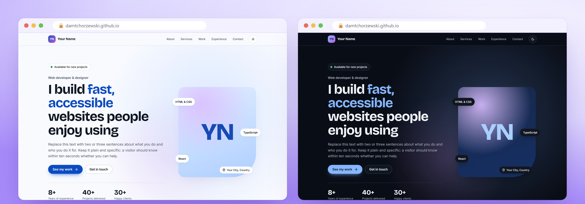
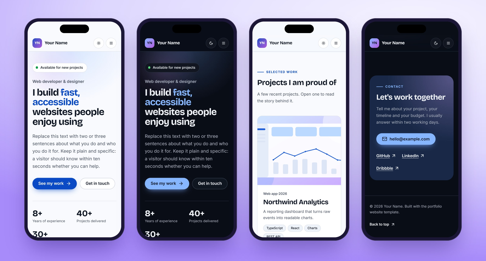

<p align="center">
  <picture>
    <source media="(prefers-color-scheme: dark)" srcset="docs/images/banner-dark.png">
    
  </picture>
</p>

<p align="center">
  
</p>

## About

<a href="https://damtchorzewski.github.io/portfolio-website-template/"></a>

A **portfolio website template** for developers and designers. It is a fast, accessible, responsive one-page site
with case-study pages, a light and a dark theme, and **one file that holds all of the content**. Fork it, replace
the placeholder text and publish it on GitHub Pages in minutes. The sample person, projects and addresses are made
up (`Your Name`, `example.com`): there is no personal data in the repository.

- **One content file.** Every text, link and number comes from `src/config/site.ts`, a typed file with a comment on
  each field. Empty a list and its section disappears from the page and the menu.
- **Accent colour from one number.** `accentHue` sets the whole palette for both themes; every colour pair passes
  WCAG AA contrast at any hue (checked from 0 to 360 in steps of 5).
- **Light and dark theme.** Follows the system setting, with a toggle that remembers the choice and no flash on load.
- **Case-study pages.** One page per project (`/projects/<slug>/`) is generated from the same file, with previous
  and next links.
- **Generated placeholder art.** Project covers and the monogram are drawn in SVG from a hue and a name, so the
  template ships with no photos and no stock images; point `image` or `photo` at your own files when you have them.
- **Accessible by default (WCAG 2.2 AA).** Skip link, landmarks, visible focus, keyboard menu, 44 px targets,
  reduced-motion support, and accessibility lint rules on the templates.
- **Fast.** Static HTML, no framework runtime, self-hosted variable fonts and one small script (theme, menu,
  reveal): Lighthouse reports 100 for performance, accessibility, best practices and SEO on the home page and on a
  case-study page, on mobile and desktop.
- **Deploys itself.** A GitHub Actions workflow checks, builds and publishes to GitHub Pages, and the site works
  under any `<owner>.github.io/<repo>/` address without editing a path.

## Tech stack

|         |                                                                                                              |
| ------- | ------------------------------------------------------------------------------------------------------------ |
| Stack   | Astro 6 (static output), TypeScript, Node 22                                                                 |
| UI      | plain CSS with design tokens (`oklch`, `light-dark()`), SVG art, Inter and Bricolage Grotesque (self-hosted) |
| Data    | none: the content is a typed object in `src/config/site.ts`                                                  |
| Tests   | Vitest (content file and helpers), ESLint with accessibility rules, `astro check`, Prettier                  |
| Hosting | GitHub Pages, deployed by GitHub Actions                                                                     |

The content, the code and the commits are in English.

## Screenshots

<p align="center">
  
</p>
<p align="center">
  
</p>

## Quick start

```bash
git clone https://github.com/DamTchorzewski/portfolio-website-template.git
cd portfolio-website-template
pnpm install
pnpm dev          # http://localhost:4321
```

Requirements: Node.js 22.12 or newer (`.nvmrc`) and pnpm 11 (`packageManager` in `package.json`).

**Make it yours** (details in [docs/content.md](docs/content.md)):

1. Use the **Use this template** button or fork the repository and clone it.
2. Open `src/config/site.ts` and replace the placeholders: name, headline, about text, skills, services, projects,
   experience, testimonials, e-mail and profile links. The editor shows what each field means.
3. Change `accentHue` to pick your colour; put your photo, CV or screenshots in `public/` and point the fields at them.
4. Replace `public/favicon.svg` with your own icon and rewrite the README and `LICENSE` for your project.
5. Push to `main`. In **Settings → Pages**, set the source to **GitHub Actions**; the workflow publishes the site.

## Scripts

| Command          | What it does                                             |
| ---------------- | -------------------------------------------------------- |
| `pnpm dev`       | development server with hot reload                       |
| `pnpm build`     | production build into `dist/`                            |
| `pnpm preview`   | serves the production build locally                      |
| `pnpm check`     | `format:check`, `lint`, `typecheck` and `test` in one go |
| `pnpm format`    | Prettier, writes the files (`format:check` only reports) |
| `pnpm lint`      | ESLint (`lint:fix` fixes what it can)                    |
| `pnpm typecheck` | `astro check`: types in `.ts` and `.astro` files         |
| `pnpm test`      | Vitest: checks the content file and the helpers          |
| `pnpm health`    | smoke check of the live site; needs `SITE_URL`           |

## Configuration

The site has no secrets and needs no environment to build. One optional variable is listed in
[.env.example](.env.example):

| Variable   | Effect                                                                                                                               |
| ---------- | ------------------------------------------------------------------------------------------------------------------------------------ |
| `SITE_URL` | the public address with its path; sets the base path and the canonical and Open Graph URLs. Empty = a build for the root of any host |

The deploy workflow reads the address from the Pages settings itself. Set a repository variable `SITE_URL` only for a
custom domain. Everything else is content: see [docs/content.md](docs/content.md).

## Structure

```
src/
  config/site.ts          ★ all content: texts, projects, links, accent hue
  lib/types.ts            the shape of the content file, with a description of each field
  lib/url.ts              base-path links, initials and the seeded random generator for the art
  styles/global.css       ★ design tokens (colours, type, radii), reset and shared components
  layouts/Base.astro      head, theme script, skip link, header and footer
  components/             Hero, About, Services, Projects, Experience, Testimonials, Contact, Header, Footer, Art, Icon
  pages/                  index.astro, projects/[slug].astro (one page per project), 404.astro
  scripts/main.ts         theme toggle, mobile menu, scroll reveal, current-section highlight
public/favicon.svg        ★ the icon; add your photo, CV and screenshots here
tests/                    Vitest tests of the content file and helpers
scripts/health.mjs        smoke check used by the deploy workflow
docs/                     documentation; docs/images/ holds the README images (generated)
.github/workflows/        deploy.yml: check, build, publish to Pages, health check
```

## Branches and workflows

Shared standards from `reops/standards`: `main` ≤ `develop` ≤ a working branch `<type>/<topic>`, two pull requests
(work into `develop`, release into `main`), Conventional Commits in English; see `git.md` and
`workflows.md` there. The one workflow, `deploy.yml`, is level 1 (a static site with a build):
a push to `develop` checks and builds, a push to `main` also publishes to GitHub Pages and runs `pnpm health`.

**Departures from the standards (and why):**

- **`pnpm check` runs inside the build job.** Level 1 has no CI; the checks are quick (about 20 seconds), so they gate
  the build instead of a separate workflow.
- **Astro 6, not 7.** Astro 7 needs Node 22.23 and the owner's laptop has 22.15; the template works on 22.12 and newer.
- **`SITE_URL` is read from the Pages settings** by the workflow, so a fork needs no edit; the variable is only for a
  custom domain.
- **README images** are made by `tools/readme-images` (profile `portfolio-website-template`) from the running site; the
  logo is a lockup drawn by the profile.

## Documentation

| Document                                 | Covers                                                                     |
| ---------------------------------------- | -------------------------------------------------------------------------- |
| [docs/content.md](docs/content.md)       | editing the content file, field by field; adding projects, photos and a CV |
| [docs/frontend.md](docs/frontend.md)     | design tokens, themes, accessibility and performance decisions             |
| [docs/deployment.md](docs/deployment.md) | GitHub Pages, the workflow, a custom domain, a fork's first deploy         |
| [docs/repository.md](docs/repository.md) | GitHub description, topics and the settings made by hand                   |

The README images (`docs/images/`) are regenerated with `tools/readme-images`, profile `portfolio-website-template`; the
working shots go to `.scratch/`. The documents in `docs/` are in English.

---

<p align="center"><a href="https://damreboot.pl"><picture><source media="(prefers-color-scheme: dark)" srcset="docs/images/damreboot/company-dark.svg"></picture></a><a href="https://www.linkedin.com/in/damian-tchorzewski-3b2388275/"><picture><source media="(prefers-color-scheme: dark)" srcset="docs/images/damreboot/linkedin-dark.svg"></picture></a><a href="mailto:damianchabracki@gmail.com"><picture><source media="(prefers-color-scheme: dark)" srcset="docs/images/damreboot/email-dark.svg"></picture></a></p>

<p align="center">
  <picture><source media="(prefers-color-scheme: dark)" srcset="docs/images/damreboot/engineered-dark.svg"></picture> Engineered by <b>Damian Chabracki</b> (DamReboot IT)
</p>
